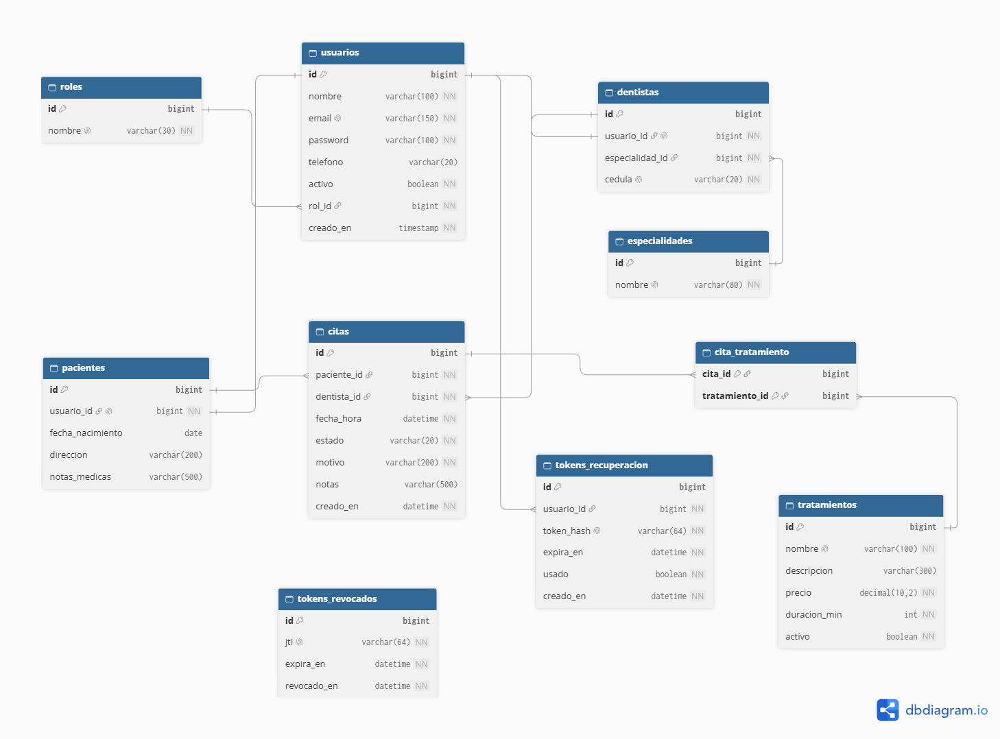

# Sistema Dental

Aplicación web full stack para la gestión de una clínica dental: agenda de citas, pacientes, dentistas y tratamientos, con tres niveles de usuario y notificaciones por correo, SMS y WhatsApp.

*Equipo 4:* David Efraín José Ramos y Jordi Moisés Alvaréz Mora

## Enlaces

| Recurso | URL |
|---|---|
| Aplicación (HTTPS) | http://194.163.143.215/login |
| URL base de la API | http://194.163.143.215/login/api |
| Prototipo de Figma | [https://www.figma.com/site/kkY4z4bqYhp9ZgdHh3M0Np/Prototipo_web?node-id=0-1&p=f&t=eFVMwEeW8NWpBnpu-0] |
| Tablero de GitHub Projects | [https://github.com/David-Ramos1010/sistema-dental] |

## Tecnologías

- *Backend:* Java 21, Spring Boot 4, Spring Security + JWT, Spring Data JPA (Hibernate), Bean Validation, JavaMailSender
- *Base de datos:* MySQL 8 con migraciones Flyway
- *Frontend:* React (Vite), Axios, React Router
- *Comunicación:* Postfix + OpenDKIM (correo propio con SPF, DKIM y DMARC), Twilio (SMS y WhatsApp)
- *Pruebas de API:* Bruno
- *Diseño:* Figma
- *Despliegue:* VPS con Nginx, Certbot (Let's Encrypt) y systemd

## Estructura del repositorio

├── backend/      API REST con Spring Boot
├── frontend/     Aplicación React
├── bruno/        Colección de pruebas de la API
├── database/     Respaldo .sql de la base de datos
└── README.md

## Roles

| Rol | Qué puede hacer |
|---|---|
| ADMIN | Acceso total: gestiona usuarios, tratamientos, pacientes y todas las citas |
| DENTISTA | Ve y gestiona sus citas, consulta pacientes y confirma o cancela citas |
| PACIENTE | Agenda y cancela sus propias citas y edita su perfil |

## Credenciales de prueba

| Rol | Correo | Contraseña |
|---|---|---|
| *Administrador (evaluación)* | admin@sistemadental.com | Admin#2026 |
| Dentista | dentista@sistemadental.com | Dentista#2026 |
| Paciente | paciente@sistemadental.com | Paciente#2026 |

Los demás usuarios de ejemplo (10 dentistas y 15 pacientes) usan la contraseña Demo#2026x.

## Instalación local

### Requisitos

Java 21, Maven (o el wrapper mvnw), MySQL 8 (no MariaDB), Node.js 20 o superior.

### Base de datos

sql
CREATE DATABASE sistema_dental CHARACTER SET utf8mb4;

Las tablas y los datos de prueba los crea Flyway al arrancar el backend (backend/src/main/resources/db/migration). En database/respaldo.sql hay un respaldo completo.

### Backend

bash
cd backend
cp src/main/resources/application.properties.example src/main/resources/application.properties

# Edita application.properties con tus credenciales (ver las variables abajo)
./mvnw spring-boot:run

Variables del archivo application.properties (no se sube al repositorio):

| Variable | Descripción |
|---|---|
| spring.datasource.* | Conexión a MySQL |
| app.jwt.secret | Clave Base64 de al menos 256 bits (openssl rand -base64 32) |
| app.frontend-url | URL del frontend, para el enlace de recuperación de contraseña |
| spring.mail.* y app.mail.from | Servidor de correo (Postfix) y remitente |
| twilio.* | Credenciales de Twilio; con twilio.enabled=false los mensajes solo se escriben en el log |

La API queda en http://localhost:8089 (ver server.port).

### Frontend

bash
cd frontend
npm install
npm run dev

## Base de datos

Diagrama entidad-relación (la relación N:M es citas con tratamientos, mediante cita_tratamiento):

mermaid

erDiagram
    ROLES ||--o{ USUARIOS : "tiene"
    USUARIOS ||--o| PACIENTES : "perfil de"
    USUARIOS ||--o| DENTISTAS : "perfil de"
    ESPECIALIDADES ||--o{ DENTISTAS : "se especializa en"
    PACIENTES ||--o{ CITAS : "agenda"
    DENTISTAS ||--o{ CITAS : "atiende"
    CITAS ||--o{ CITA_TRATAMIENTO : "incluye"
    TRATAMIENTOS ||--o{ CITA_TRATAMIENTO : "se aplica en"
    USUARIOS ||--o{ TOKENS_RECUPERACION : "solicita"

    ROLES {
        bigint id PK
        varchar nombre UK
    }
    USUARIOS {
        bigint id PK
        varchar nombre
        varchar email UK
        varchar password "BCrypt"
        varchar telefono
        boolean activo
        bigint rol_id FK
        timestamp creado_en
    }
    ESPECIALIDADES {
        bigint id PK
        varchar nombre UK
    }
    DENTISTAS {
        bigint id PK
        bigint usuario_id FK, UK
        bigint especialidad_id FK
        varchar cedula UK
    }
    PACIENTES {
        bigint id PK
        bigint usuario_id FK, UK
        date fecha_nacimiento
        varchar direccion
        varchar notas_medicas
    }
    TRATAMIENTOS {
        bigint id PK
        varchar nombre UK
        varchar descripcion
        decimal precio
        int duracion_min
        boolean activo
    }
    CITAS {
        bigint id PK
        bigint paciente_id FK
        bigint dentista_id FK
        datetime fecha_hora
        varchar estado
        varchar motivo
        varchar notas
        datetime creado_en
    }
    CITA_TRATAMIENTO {
        bigint cita_id PK, FK
        bigint tratamiento_id PK, FK
    }
    TOKENS_RECUPERACION {
        bigint id PK
        bigint usuario_id FK
        varchar token_hash UK
        datetime expira_en
        boolean usado
        datetime creado_en
    }
    TOKENS_REVOCADOS {
        bigint id PK
        varchar jti UK
        datetime expira_en
        datetime revocado_en
    }

## API

Autenticación con JWT en el encabezado Authorization: Bearer <token>. Los listados aceptan page, size y sort, y filtran en el servidor.

| Módulo | Rutas principales |
|---|---|
| Autenticación | POST /api/auth/login, /registro, /logout, /olvide-password, /restablecer-password, GET /api/auth/me |
| Usuarios (ADMIN) | GET/POST /api/admin/usuarios, GET/PUT /api/admin/usuarios/{id}, PATCH /api/admin/usuarios/{id}/activo |
| Pacientes | GET /api/pacientes (ADMIN y DENTISTA), GET/PUT /api/pacientes/{id}, GET/PUT /api/pacientes/mi-perfil |
| Tratamientos | GET /api/tratamientos; POST, PUT y DELETE solo ADMIN |
| Citas | GET/POST /api/citas, GET/PUT/DELETE /api/citas/{id}, PATCH /api/citas/{id}/estado |
| Catálogos | GET /api/dentistas, GET /api/especialidades |

Los errores se devuelven en JSON con el código HTTP correspondiente (400, 401, 403, 404, 422 y 500).

## Pruebas con Bruno

La colección está en la carpeta bruno/. Ábrela con Bruno (Open Collection), elige el entorno local y ejecuta la colección completa. Incluye login y obtención del token, uso del token en rutas protegidas, permisos por rol y casos de error a propósito (401, 403, 404, 422 y 400).

## Comunicación con el usuario

Al crear, confirmar, cancelar o reprogramar una cita, el paciente recibe un correo (Postfix propio con SPF, DKIM y DMARC), un SMS y un WhatsApp (Twilio).

## Seguridad

- Contraseñas con BCrypt, con la regla de al menos 8 caracteres, una mayúscula, un número y un carácter especial, validada en frontend y backend.
- Secretos fuera del repositorio (application.properties está en .gitignore; se incluye application.properties.example).
- JWT con identificador (jti): el logout invalida el token.

## Limitaciones conocidas

- Las cuentas de prueba de Twilio solo envían a números verificados y con plantillas predefinidas.
- El conflicto de horarios compara la hora exacta de inicio, no la duración de los tratamientos.
- Restablecer la contraseña no cierra las sesiones ya abiertas, que caducan solas.

## Despliegue

Backend como JAR con systemd, frontend como build estático, ambos detrás de Nginx con HTTPS de Let's Encrypt, y MySQL en el mismo VPS.

## Aportes del equipo

| Integrante | Responsabilidad principal |
|---|---|
| David Efraín José Ramos | Backend (API, seguridad, base de datos, comunicación) |
| Jordi Moises Alvarez Mora | [Frontend, Figma, etc.] |